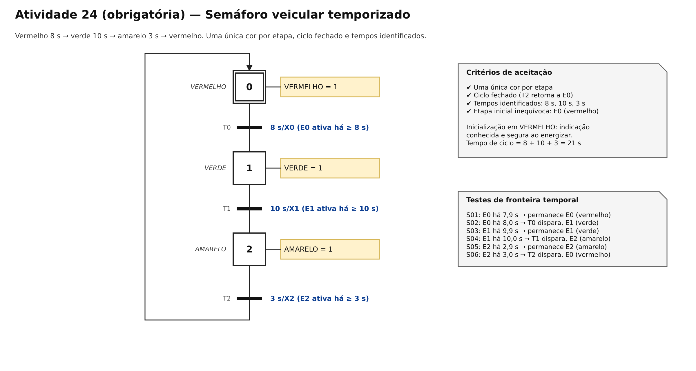
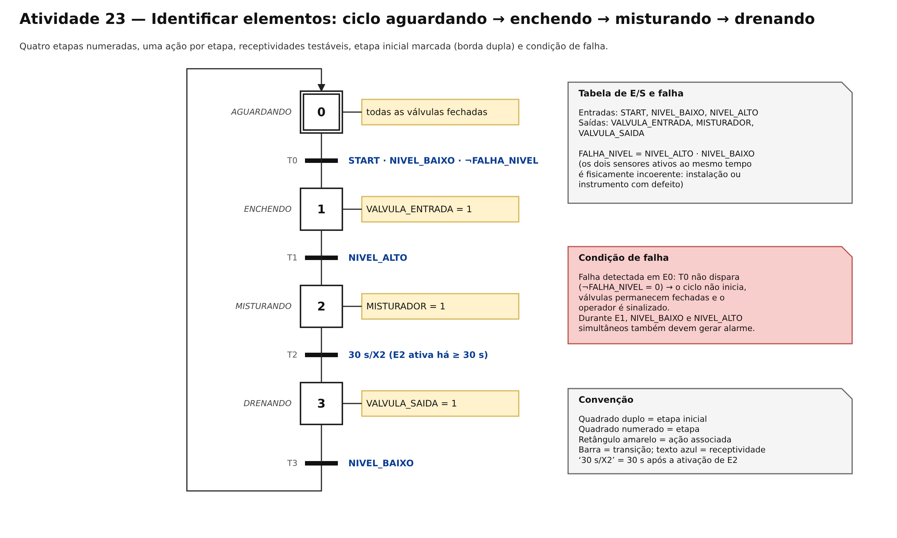
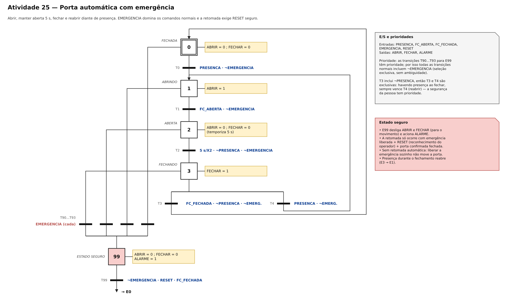
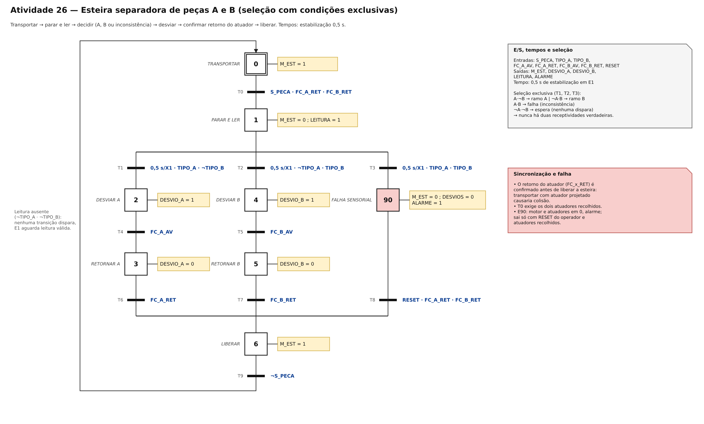

# TP05 — Sistemas sequenciais e GRAFCET/SFC

**UC Sistemas Automatizados** · Prof. Calvetti · Engenharia de Software — USJT
**Autor:** Lucas Antonio Gomes (RA 823126987) · **Data:** 26/09/2026

## Objetivo

Modelar e validar comportamentos sequenciais usando GRAFCET (IEC 60848) no diagrams.net: identificar elementos (atividade 23), modelar o semáforo temporizado (atividade 24, obrigatória), a porta automática com emergência (atividade 25) e a esteira separadora (atividade 26), e percorrer os modelos manualmente (atividade 27).

## Artefatos

| Arquivo | Conteúdo |
|---|---|
| `grafcet.drawio` | fonte editável com 5 páginas (A23, A24, A25, A26 e exemplo da aula) |
| `semaforo.png` | atividade 24 — **obrigatória** |
| `reservatorio.png` | atividade 23 — identificar elementos |
| `porta.png` | atividade 25 — porta automática com emergência |
| `esteira.png` | atividade 26 — esteira separadora |
| `exemplo-esteira-atuador.png` | exemplo desenvolvido em aula (esteira com atuador separador) |
| `casos_teste.csv` | 39 cenários: normal, fronteira temporal e falha, com esperado, obtido e situação |
| `percurso_semaforo.csv` | atividade 27 — percurso manual passo a passo |
| `NOTAS.md` | limites, hipóteses e melhorias |

Para editar: <https://app.diagrams.net> → *Arquivo → Abrir de → Dispositivo* → `grafcet.drawio`. Cada atividade está em uma página (abas na parte inferior). Exportação: *Arquivo → Exportar como → PNG* (marcar "Todas as páginas" ou exportar página a página).

## Convenções

| Elemento | Representação | Regra |
|---|---|---|
| Etapa | quadrado numerado | identificador único |
| Etapa inicial | quadrado com **borda dupla** | situação ativa na inicialização |
| Ação | retângulo amarelo à direita, ligado à etapa | tag = valor, válida enquanto a etapa está ativa |
| Transição | barra horizontal preta (T0, T1, …) | sempre entre etapas |
| Receptividade | texto azul à direita da barra | expressão booleana ou temporal testável |
| Temporização | `8 s/X0` | verdadeira quando a etapa E0 está ativa há pelo menos 8 s |
| Operadores | `·` = AND, `+` = OR, `¬` = NOT | |
| Etapa de segurança/falha | quadrado vermelho (E90, E99) | todas as saídas perigosas em 0 |

## Atividade 24 (obrigatória) — Semáforo veicular

| Etapa | Situação | Ação |
|---|---|---|
| E0 (inicial) | vermelho | VERMELHO = 1 |
| E1 | verde | VERDE = 1 |
| E2 | amarelo | AMARELO = 1 |

| Transição | De → para | Receptividade |
|---|---|---|
| T0 | E0 → E1 | 8 s/X0 |
| T1 | E1 → E2 | 10 s/X1 |
| T2 | E2 → E0 | 3 s/X2 |

| Caso | Etapa inicial | Tempo aplicado | Esperado | Obtido | Situação |
|---|---|---|---|---|---|
| S01 | E0 | 7,9 s | permanece E0 (vermelho) | E0 | PASSA |
| S02 | E0 | 8,0 s | E1 (verde) | E1 | PASSA |
| S03 | E1 | 9,9 s | permanece E1 | E1 | PASSA |
| S04 | E1 | 10,0 s | E2 (amarelo) | E2 | PASSA |
| S05 | E2 | 2,9 s | permanece E2 | E2 | PASSA |
| S06 | E2 | 3,0 s | E0 (vermelho retorna) | E0 | PASSA |

Aceitação: uma única cor por etapa ✔ · ciclo fechado ✔ · tempos identificados ✔ · etapa inicial inequívoca ✔. Ciclo completo = 21 s.

### Atividade 27 — Percurso manual (semáforo)

| Passo | Marcação ativa | Tempo na etapa | Transição | Nova marcação |
|---|---|---|---|---|
| 0 | E0 | 7,9 s | nenhuma | E0 |
| 1 | E0 | 8,0 s | T0 | E1 |
| 2 | E1 | 9,9 s | nenhuma | E1 |
| 3 | E1 | 10,0 s | T1 | E2 |
| 4 | E2 | 2,9 s | nenhuma | E2 |
| 5 | E2 | 3,0 s | T2 | E0 |

Em cada linha: (1) marcação ativa, (2) entradas/tempo fixados, (3) habilitação verificada **antes** da receptividade, (4) nova marcação registrada. Os percursos das outras atividades estão em `casos_teste.csv`.

## Atividade 23 — Identificar elementos (reservatório)

| ID | Etapa | Ação | Transição de saída |
|---|---|---|---|
| E0 (inicial) | aguardando | todas as válvulas fechadas | T0: START · NIVEL_BAIXO · ¬FALHA_NIVEL |
| E1 | enchendo | VALVULA_ENTRADA = 1 | T1: NIVEL_ALTO |
| E2 | misturando | MISTURADOR = 1 | T2: 30 s/X2 |
| E3 | drenando | VALVULA_SAIDA = 1 | T3: NIVEL_BAIXO → E0 |

**Condição de falha:** `FALHA_NIVEL = NIVEL_ALTO · NIVEL_BAIXO`. Os dois sensores ativos ao mesmo tempo são fisicamente incoerentes; o ciclo não inicia (caso R07).

## Atividade 25 — Porta automática com emergência

| Etapa | Ação | Saída |
|---|---|---|
| E0 fechada (inicial) | aguardar presença | ABRIR = 0; FECHAR = 0 |
| E1 abrindo | mover para abrir | ABRIR = 1 |
| E2 aberta | manter aberta por 5 s | ABRIR = 0; FECHAR = 0 |
| E3 fechando | mover para fechar | FECHAR = 1 |
| E99 segura | interromper movimento | ABRIR = 0; FECHAR = 0; ALARME = 1 |

| Transição | Receptividade | Finalidade |
|---|---|---|
| T0: E0 → E1 | PRESENCA · ¬EMERGENCIA | iniciar abertura |
| T1: E1 → E2 | FC_ABERTA · ¬EMERGENCIA | confirmar aberta |
| T2: E2 → E3 | 5 s/X2 · ¬PRESENCA · ¬EMERGENCIA | iniciar fechamento |
| T3: E3 → E0 | FC_FECHADA · ¬PRESENCA · ¬EMERGENCIA | confirmar fechamento |
| T4: E3 → E1 | PRESENCA · ¬EMERGENCIA | reabrir diante de presença |
| T90…T93: E0…E3 → E99 | EMERGENCIA | prioridade segura |
| T99: E99 → E0 | ¬EMERGENCIA · RESET · FC_FECHADA | retomada controlada |

Decisões: (1) todas as transições normais incluem `¬EMERGENCIA`, então nunca disputam com T90…T93; (2) T3 inclui `¬PRESENCA`, então T3 e T4 são exclusivas e a reabertura sempre vence; (3) liberar a emergência sozinho **não** move a porta: é preciso RESET e porta confirmada fechada.

| Caso | Estado inicial | Evento | Esperado | Obtido | Situação |
|---|---|---|---|---|---|
| P01 | E0 | PRESENCA = 1 | E1; ABRIR = 1 | E1 | PASSA |
| P02 | E1 | FC_ABERTA = 1 | E2; movimento parado | E2 | PASSA |
| P03 | E3 | PRESENCA = 1 | E1; reabrir | E1 | PASSA |
| P04 | E1 | EMERGENCIA = 1 | E99; saídas = 0 | E99 | PASSA |
| P05 | E99 | RESET = 1 e emergência ainda ativa | permanecer E99 | E99 | PASSA |
| P06 | E99 | RESET = 1; emergência = 0; FC_FECHADA = 1 | retornar E0 | E0 | PASSA |

Mais 6 casos (P07–P12: fronteira de 5 s, presença mantendo aberta, retomada sem RESET, emergência dominando presença) estão em `casos_teste.csv`.

## Atividade 26 — Esteira separadora

| Condição (após 0,5 s em E1) | Caminho | Ação |
|---|---|---|
| TIPO_A · ¬TIPO_B | ramo A (E2 → E3) | DESVIO_A |
| ¬TIPO_A · TIPO_B | ramo B (E4 → E5) | DESVIO_B |
| TIPO_A · TIPO_B | falha (E90) | parar tudo e sinalizar inconsistência |
| ¬TIPO_A · ¬TIPO_B | espera | nenhuma transição dispara |

| Etapa | Ação | | Entrada | Significado |
|---|---|---|---|---|
| E0 transportar (inicial) | M_EST = 1 | | S_PECA | peça na estação |
| E1 parar e ler | M_EST = 0; LEITURA = 1 | | TIPO_A / TIPO_B | leitura do tipo |
| E2 / E4 desviar | DESVIO_A / DESVIO_B = 1 | | FC_A_AV / FC_B_AV | atuador avançado |
| E3 / E5 retornar | DESVIO_x = 0 | | FC_A_RET / FC_B_RET | atuador recolhido |
| E6 liberar | M_EST = 1 | | RESET | reconhecimento do operador |
| E90 falha | M_EST = 0; desvios = 0; ALARME = 1 | | | |

Tempos: 0,5 s de estabilização em E1 antes da leitura. A esteira só volta a andar depois de confirmar o atuador recolhido (T6/T7), e T0 exige os dois atuadores recolhidos.

| Teste | Leitura A | Leitura B | Caminho | Esperado | Obtido | Situação |
|---|---|---|---|---|---|---|
| E01 | 0 | 0 | espera | sem desvio (E1) | E1 | PASSA |
| E02 | 1 | 0 | A | DESVIO_A = 1 (E2) | E2 | PASSA |
| E03 | 0 | 1 | B | DESVIO_B = 1 (E4) | E4 | PASSA |
| E04 | 1 | 1 | falha | movimentos = 0 (E90) | E90 | PASSA |
| E05 | retorno não confirmado | – | bloqueio | esteira = 0 (permanece E3) | E3 | PASSA |

## Resultados

Os 39 cenários de `casos_teste.csv` foram executados aplicando as regras de evolução do GRAFCET (habilitação + receptividade, disparo simultâneo e atualização da marcação em uma única mudança). **Todos passaram.** Nenhuma correção foi necessária no semáforo. Na porta, a primeira versão de T3 não tinha `¬PRESENCA`, o que deixava T3 e T4 verdadeiras ao mesmo tempo quando a porta chegava ao fim de curso com alguém passando; a condição foi acrescentada para tornar a seleção exclusiva.

## Checklist de aceitação

- [x] Etapa inicial claramente marcada (borda dupla)
- [x] Toda etapa tem significado e identificação
- [x] Toda transição possui receptividade testável
- [x] Seleções não apresentam ambiguidade (condições exclusivas)
- [x] Paralelismos possuem sincronização coerente (não usados nestes modelos)
- [x] Emergência conduz a ações seguras
- [x] Casos de teste cobrem normal, limite e falha

## Active recall

1. **Mesma entrada, ações diferentes:** quando o estado atual é diferente; o estado guarda a história relevante.
2. **Disparo de transição:** todas as etapas imediatamente anteriores ativas **e** receptividade verdadeira.
3. **Seleção perigosa:** duas receptividades verdadeiras sem prioridade explícita tornam o comportamento ambíguo.
4. **Convergência paralela:** aguarda a ativação de todas as etapas finais dos ramos, além da receptividade.
5. **GRAFCET × SFC:** GRAFCET é linguagem de especificação funcional (IEC 60848); SFC estrutura programas de CLP (IEC 61131-3).
6. **Fronteiras temporais:** erros de comparação (`>` × `>=`) aparecem logo antes, exatamente no limite ou logo depois do tempo.
