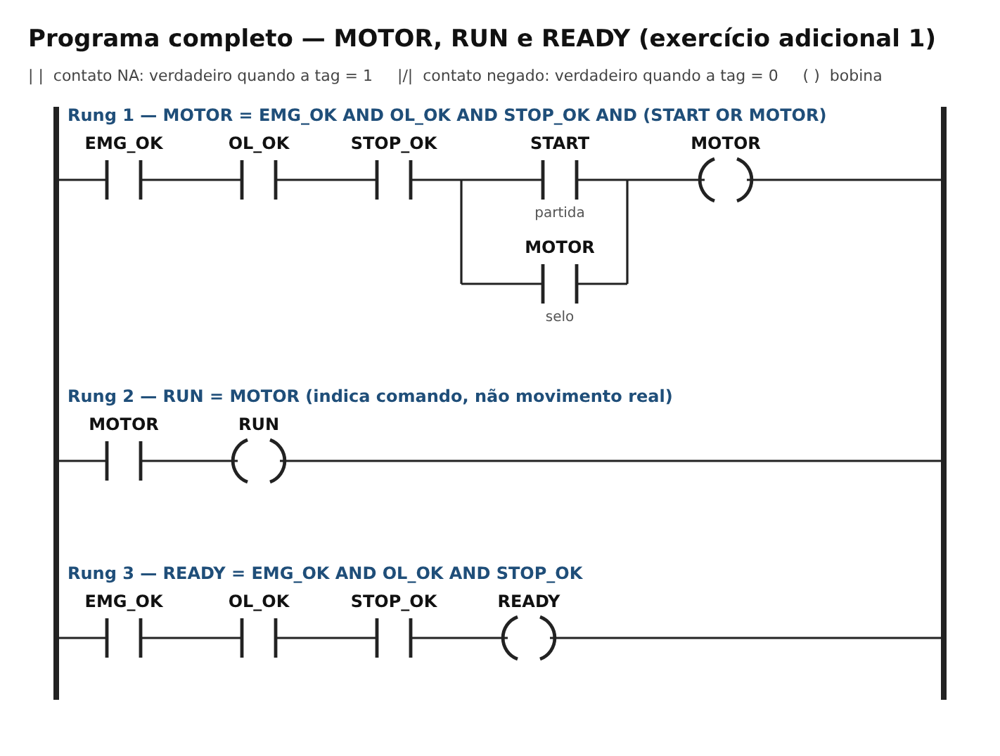
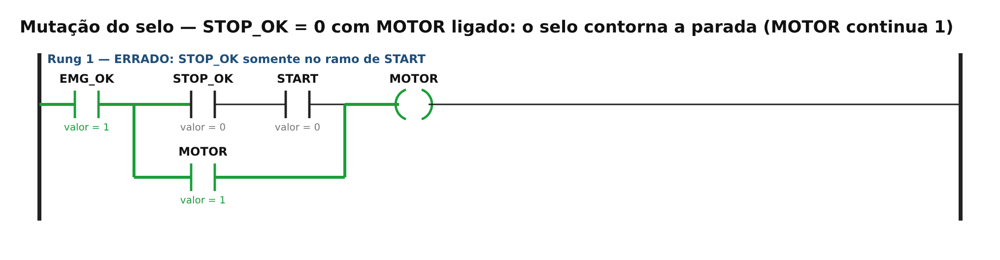
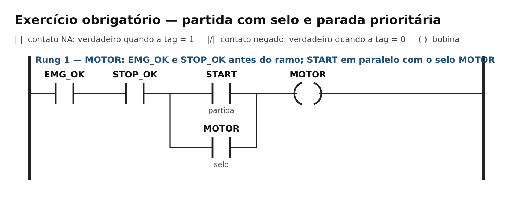
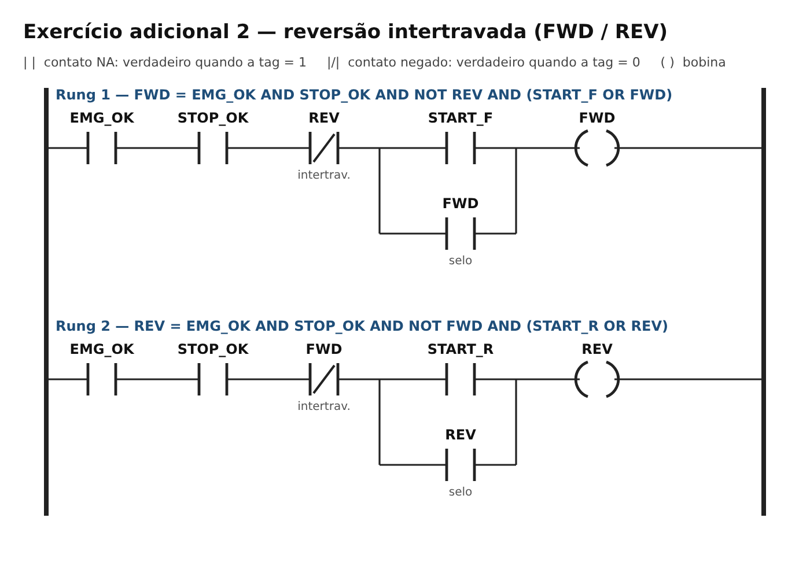
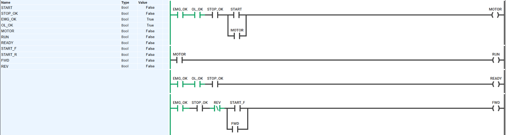

# TP06 — CLP e linguagem Ladder

**UC Sistemas Automatizados** · Prof. Calvetti · Engenharia de Software — USJT
**Autor:** Lucas Antonio Gomes (RA 823126987) · **Data:** 03/10/2026

**Link do projeto (PLC Simulator Online):** [abrir programa](https://app.plcsimulator.online/taecaRlNp0qLNHGk1WpJ)

## Objetivo

Implementar e validar a partida de motor com **selo** e **parada prioritária**, com emergência e sobrecarga como permissivos, as indicações RUN e READY, e uma reversão intertravada. A retomada após qualquer falha exige nova ação de START.

## Estrutura

```
TP06/
├── README.md
├── programa_ladder.md        ← programa (Ladder em texto + ST), tags e passo a passo no simulador
├── casos_teste.csv           ← 29 casos: esperado, obtido e situação
├── diagramas/
│   ├── programa_minimo.png        ← exercício obrigatório
│   ├── programa_ladder.png        ← programa completo (MOTOR, RUN, READY)
│   ├── reversao_intertravada.png  ← exercício adicional 2
│   ├── estado_partida.png / estado_selo.png / estado_parada.png / estado_falha.png
│   └── mutacao_selo_erro.png      ← exercício resolvido 2 (STOP na posição errada)
└── capturas/                 ← capturas do PLC Simulator Online (partida, selo, parada, falha)
```

## Tags

START, STOP_OK, EMG_OK, OL_OK, MOTOR, RUN e READY (e START_F, START_R, FWD, REV na reversão). Convenção completa em [`programa_ladder.md`](programa_ladder.md). Os nomes terminados em `_OK` valem **1 em condição normal**.

## Equação

```
MOTOR = EMG_OK AND OL_OK AND STOP_OK AND (START OR MOTOR)
RUN   = MOTOR
READY = EMG_OK AND OL_OK AND STOP_OK
```



**Por que STOP_OK fica antes do ramo de selo:** em série antes da divergência, ele interrompe ao mesmo tempo o caminho de START e o caminho de retenção (contato MOTOR). Se ficasse só no ramo de START, o selo contornaria a parada. O exercício resolvido 2 demonstra esse defeito (caso X01):



## Exercício obrigatório — partida com selo



| ID | Condição inicial | Ação | Esperado | Obtido | Situação |
|---|---|---|---|---|---|
| T01 | M=0; permissivos=1 | START=1 | M=1 | M=1 | PASSA |
| T02 | M=1; permissivos=1 | START=0 | M=1 (selo) | M=1 | PASSA |
| T03 | M=1; EMG_OK=1 | STOP_OK=0 | M=0 | M=0 | PASSA |
| T04 | M=1; STOP_OK=1 | EMG_OK=0 | M=0 | M=0 | PASSA |
| T05 | M=0; EMG_OK=0 | START=1 | M=0 | M=0 | PASSA |

Traço da sequência pedida (EMG_OK = STOP_OK = 1, pulsar START, soltar, remover STOP_OK): **MOTOR = 0 → 1 → 1 → 0**.

## Testes de falha e retomada

| Teste | Preparação | Ação | Resposta correta | Obtido | Situação |
|---|---|---|---|---|---|
| F01 | MOTOR=1 | OL_OK=0 | MOTOR=0 | MOTOR=0 | PASSA |
| F02 | OL_OK=0 e MOTOR=0 | START=1 | MOTOR permanece 0 | MOTOR=0 | PASSA |
| F03 | falha removida, START=0 | OL_OK=1 | MOTOR permanece 0 | MOTOR=0 | PASSA |
| F04 | permissivos restaurados | novo pulso START | MOTOR=1 | MOTOR=1 | PASSA |
| F05 | MOTOR=1 | EMG_OK=0 | MOTOR=0 | MOTOR=0 | PASSA |
| F06 | emergência liberada, sem START | EMG_OK=1 | MOTOR permanece 0 | MOTOR=0 | PASSA |

A retomada sem nova partida seria perigosa: a máquina voltaria a se mover só porque um permissivo foi restaurado. No circuito proposto, a queda de MOTOR desfaz o selo, então START precisa ser acionado de novo.

## Exercício adicional 1 — RUN e READY

| Cenário | READY | RUN | Interpretação |
|---|---|---|---|
| Permissivos saudáveis e motor parado (I01) | 1 | 0 | disponível, sem movimento comandado |
| Motor comandado (I02) | 1 | 1 | disponível e comandado |
| EMG_OK=0 / OL_OK=0 / STOP_OK=0 com motor ligado (I03–I05) | 0 | 0 | indisponível e desenergizado |

READY=1 com RUN=0 é possível; RUN=1 com READY=0 não ocorre. **RUN indica o comando do programa, não movimento real**: não comprova rotação, corrente nem fechamento do contator.

## Exercício adicional 2 — reversão intertravada



| Caso | START_F | START_R | FWD esperado | REV esperado | Obtido | Situação |
|---|---|---|---|---|---|---|
| R01 | 1 | 0 | 1 | 0 | FWD=1; REV=0 | PASSA |
| R02 | 0 | 1 com FWD=1 | 1 | 0 | FWD=1; REV=0 | PASSA |
| R03 | 0 | 1 após STOP | 0 | 1 | FWD=0; REV=1 | PASSA |
| R04 | 1 | 1 (repouso) | conforme política: FWD primeiro | nunca simultâneo | FWD=1; REV=0 | PASSA |
| R05 | qualquer | qualquer, com EMG_OK=0 | 0 | 0 | FWD=0; REV=0 | PASSA |

Em máquina real, a reversão também exige intertravamento elétrico (contatos auxiliares NF cruzados nos contatores) e mecânico, além de tempo de transição. O intertravamento lógico sozinho não cobre contator soldado ou falha de saída.

## Evidências

- Link do projeto no topo deste README (testado em janela anônima).
- [`casos_teste.csv`](casos_teste.csv): 29 casos (T01–T05, F01–F06, M01–M06, I01–I05, R01–R05, X01–X02). Todos foram repetidos no PLC Simulator Online, com o programa de 5 rungs (MOTOR, RUN, READY, FWD, REV) e deram o resultado esperado (coluna `conferido_plc_simulator`). A mutação X01 foi carregada à parte (STOP_OK dentro do ramo de START) e o simulador confirmou o defeito: com MOTOR ligado, STOP_OK = 0 não desligou o motor.
- Capturas do simulador em `capturas/` (os estados de referência desenhados estão em `diagramas/estado_*.png`):

| Partida (START = 1) | Selo (START solto, MOTOR mantido) |
|---|---|
|  |  |
| **Parada (STOP_OK = 0)** | **Falha (OL_OK = 0: MOTOR = 0 e READY = 0)** |
|  |  |

## Active recall

1. **Ciclo de varredura:** leitura das entradas (imagem de entradas), execução do programa e atualização das saídas, com diagnóstico e comunicação.
2. **Imagem de entradas:** fornece ao programa uma cópia coerente dos sinais durante toda a varredura; uma mudança após a leitura só é vista no ciclo seguinte.
3. **Série e paralelo:** série = AND; paralelo = OR; contato negado = NOT.
4. **STOP antes do selo:** para interromper ao mesmo tempo o caminho de START e o de retenção.
5. **O que RUN comprova:** apenas o estado comandado no programa.
6. **Emergência simulada não certifica segurança:** o simulador não avalia hardware, arquitetura, falhas físicas, tempo de parada nem requisitos de segurança funcional.

## Limites

A simulação valida a **lógica acadêmica** e não certifica segurança funcional. Uma parada de emergência real exige análise de risco, componentes e arquitetura adequados (por exemplo, relé de segurança e categoria/PL conforme ISO 13849), diagnóstico e validação. O simulador não avalia contatos soldados, falhas de fiação nem tempo mecânico de parada.
