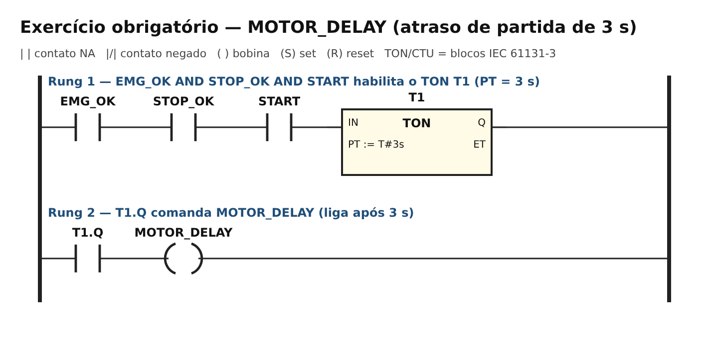
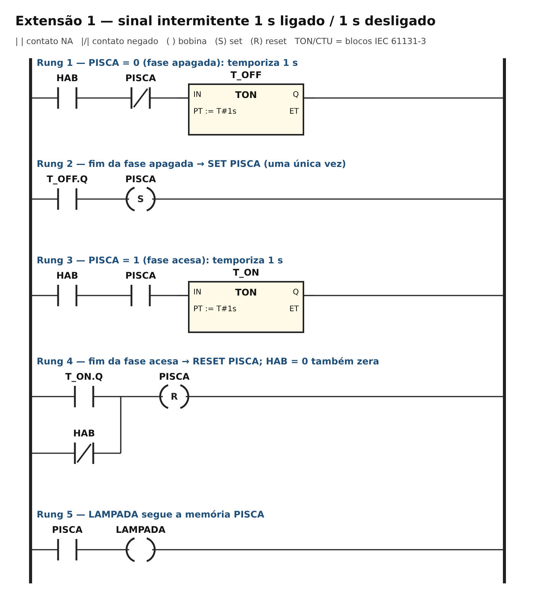
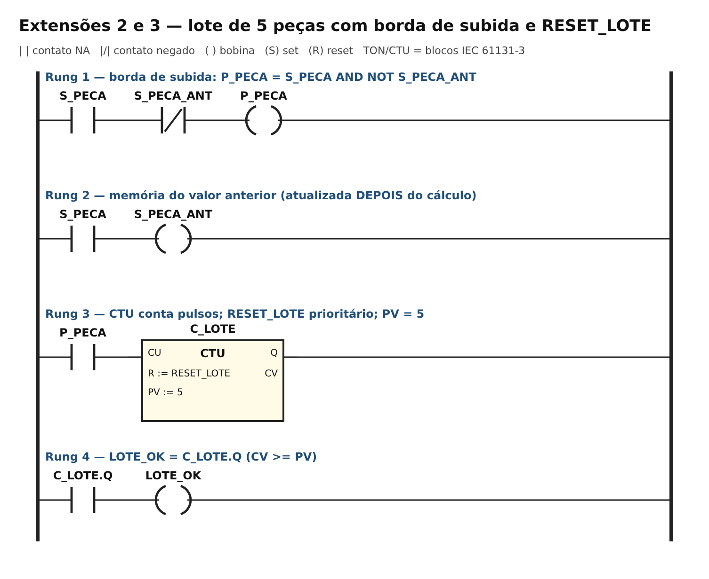
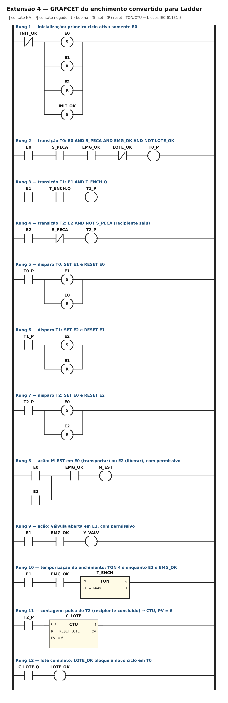

# TP07 — Programação sequencial de CLP (temporização e contagem)

**UC Sistemas Automatizados** · Prof. Calvetti · Engenharia de Software — USJT
**Autor:** Lucas Antonio Gomes (RA 823126987) · **Data:** 10/10/2026 · **Simulador:** app.plcsimulator.online (versão web de out/2026)

**Links (PLC Simulator Online):**
- Obrigatório + extensões 1 a 3 (TON, pisca, CTU): [abrir programa](https://app.plcsimulator.online/ES1GCcj5YrwsCx91R7rU)
- Extensão 4 (GRAFCET do enchimento em Ladder): [abrir programa](https://app.plcsimulator.online/kdpEjSv3irJ1KJjogAez)

## Objetivo

Transformar requisitos sequenciais em programas Ladder observáveis e testáveis: atraso de partida com **TON**, sinal intermitente com memória de fase, contagem de eventos com **CTU** e detecção de borda, zeragem com prioridade explícita e conversão de um **GRAFCET** (enchimento) para Ladder.

## Estrutura

```
TP07/
├── README.md
├── programa_ladder.md          ← programa comentado, tags, ST equivalente e decisões
├── casos_teste.csv             ← 25 casos: esperado, obtido e situação
├── planilha_ciclos.csv         ← traço do ciclo do enchimento (contingência)
├── traco_pisca.csv             ← LAMPADA a cada 0,5 s durante 6 s
├── tabela_eventos_lote.csv     ← uma borda por peça
├── diagramas/                  ← os quatro programas Ladder
└── capturas/                   ← capturas do simulador
```

## Tags e prioridades

Tabela completa em [`programa_ladder.md`](programa_ladder.md). Prioridades adotadas:
- **Permissivos dominam:** `EMG_OK` e `STOP_OK` (1 = normal) estão em série antes de qualquer temporização ou ação de movimento.
- **RESET_LOTE domina a contagem** quando chega junto com uma nova peça.
- **SET/RESET do pisca:** cada fase tem o seu temporizador; a inversão ocorre uma vez por conclusão.

## Exercício obrigatório — MOTOR_DELAY



TON: **IN** = condição de habilitação, **PT** = 3 s, **ET** = tempo decorrido, **Q** = 1 quando ET alcança PT.

| ID | Ação | Esperado | Obtido | Situação |
|---|---|---|---|---|
| T01 | START por 2 s | Q=0 e MOTOR_DELAY=0 (ET = 2,0 s) | Q=0; MOTOR_DELAY=0; ET=2,0 | PASSA |
| T02 | START por 3 s | Q=1 e MOTOR_DELAY=1 | Q=1; MOTOR_DELAY=1; ET=3,0 | PASSA |
| T03 | STOP_OK=0 durante ET | ET zera e saída=0 | ET=0,0; MOTOR_DELAY=0 | PASSA |
| T04 | EMG_OK=0 com saída ligada | saída=0 | antes 1, depois 0 | PASSA |
| T05 | Liberar falha sem START | saída permanece 0 | MOTOR_DELAY=0; ET=0,0 | PASSA |
| T06 | Exercício resolvido 1: START cai em 2,5 s | TON volta ao estado inicial; bomba 0 | ET=0; saída=0 | PASSA |
| T07 | Fronteira 2,9 s / 3,0 s | 0 / 1 | 0 / 1 | PASSA |

## Extensão 1 — sinal intermitente (1 s / 1 s)



| Tempo (s) | 0,5 | 1,0 | 1,5 | 2,0 | 2,5 | 3,0 | 3,5 | 4,0 | 4,5 | 5,0 | 5,5 | 6,0 |
|---|---|---|---|---|---|---|---|---|---|---|---|---|
| LAMPADA | 0 | 1 | 1 | 0 | 0 | 1 | 1 | 0 | 0 | 1 | 1 | 0 |

Seis inversões em seis segundos, uma por conclusão de temporizador. No PLC Simulator Online as inversões foram medidas em 1,08 / 2,07 / 3,13 / 4,11 / 5,18 / 6,16 s: cada uma chega com cerca de 0,1 s de atraso, que é a varredura seguinte à conclusão do timer. Por isso, lida exatamente em t = 1,0 s a lâmpada ainda aparece apagada; lida no meio de cada segundo, a sequência é a mesma da tabela. A memória PISCA guarda a fase; quando um timer conclui, o SET/RESET muda a fase e a habilitação daquele timer cai na varredura seguinte, então ele não volta a inverter.

## Extensão 2 — lote completo (CTU, PV = 5)



| Peça | Bordas detectadas | CV após o evento | LOTE_OK |
|---|---|---|---|
| 1 | 1 | 1 | 0 |
| 2 | 1 | 2 | 0 |
| 3 | 1 | 3 | 0 |
| 4 | 1 | 4 | 0 |
| 5 | 1 | 5 | 1 |
| sensor mantido em 1 por 50 varreduras | nenhum novo pulso | 1 (não conta de novo) | — |

Cada peça mantém o sensor em 1 por 3 varreduras, e mesmo assim gera um único incremento. A borda é `P_PECA = S_PECA AND NOT S_PECA_ANT`, com `S_PECA_ANT` atualizado **depois** do cálculo (a ordem dos rungs importa).

## Extensão 3 — zeragem controlada

| ID | Situação | Esperado | Obtido | Situação |
|---|---|---|---|---|
| Z01 | RESET com CV=0 | CV=0 | CV=0 | PASSA |
| Z02 | RESET com CV=3 | CV=0 | 3 → 0 | PASSA |
| Z03 | RESET com CV=5 e LOTE_OK=1 | CV=0; LOTE_OK=0 | 5/1 → 0/0 | PASSA |
| Z04 | RESET e borda na mesma varredura | CV=0 (RESET prioritário) | CV=0 | PASSA |
| Z05 | Nova peça depois do reset | CV=1 | CV=1 | PASSA |

**Prioridade adotada: RESET domina a contagem simultânea**, como no CTU da IEC 61131-3.

## Extensão 4 — GRAFCET do enchimento para Ladder



| ID | Requisito |
|---|---|
| R1 | A esteira transporta recipientes até o sensor. |
| R2 | A detecção para a esteira e inicia o enchimento. |
| R3 | A válvula permanece aberta durante 4 s. |
| R4 | Depois do enchimento, a esteira libera o recipiente. |
| R5 | Cada recipiente concluído incrementa o lote. |
| R6 | Ao atingir 6, LOTE_OK acende e bloqueia novo ciclo. |
| R7 | RESET_LOTE zera a contagem e libera a produção. |

Traço do ciclo normal (`planilha_ciclos.csv`, varredura de 0,1 s):

| Instante | Etapa | M_EST | Y_VALV | T_ENCH.ET | CV | LOTE_OK |
|---|---|---|---|---|---|---|
| t0 sem peça | E0 | 1 | 0 | 0,0 | 0 | 0 |
| t1 S_PECA=1 | E1 | 0 | 1 | 0,1 | 0 | 0 |
| t2 enchendo | E1 | 0 | 1 | 2,1 | 0 | 0 |
| t3 ET = 4 s | E1 | 0 | 1 | 4,0 | 0 | 0 |
| t3+ liberando | E2 | 1 | 0 | 0,0 | 0 | 0 |
| t4 S_PECA cai | E0 | 1 | 0 | 0,0 | 1 | 0 |
| t5 novo ciclo | E0 | 1 | 0 | 0,0 | 1 | 0 |

Em t3 o timer já chegou a 4 s, mas a transição só dispara na varredura seguinte porque as condições são calculadas antes do bloco de temporização: é a latência de uma varredura vista na Semana 6.

| ID | Falha / caso | Resposta correta | Obtido | Situação |
|---|---|---|---|---|
| G01 | ciclo normal | volta a E0; CV=1 | E0; CV=1 | PASSA |
| G02 | duas etapas ativas? | nunca | 0 ocorrências | PASSA |
| G03 | EMG_OK=0 durante o enchimento | desenergizar movimentos | M_EST=0; Y_VALV=0 | PASSA |
| G04 | S_PECA preso em 1 | permanecer em E2 | E2 | PASSA |
| G05 | TON não concluído | permanecer em E1 | E1; Y_VALV=1 | PASSA |
| G06 | CV=6 | bloquear novo ciclo | CV=6; LOTE_OK=1; fica em E0 | PASSA |
| G07 | RESET_LOTE | zera e libera | CV=0; avança para E1 | PASSA |
| G08 | S_PECA oscila em E1 | receptividade fora da etapa não avança | E1 | PASSA |

## Evidências

- Links dos dois programas no topo. A extensão 4 ficou em um programa separado porque usa as mesmas tags `S_PECA`, `C_LOTE` e `LOTE_OK` das extensões 2 e 3, com PV = 6.
- [`casos_teste.csv`](casos_teste.csv): 25 casos com esperado, obtido e situação; **todos passaram**. O obtido veio da execução varredura a varredura dos programas desta pasta e todos os casos foram repetidos no PLC Simulator Online (coluna `conferido_plc_simulator`). Valores medidos no simulador: T01 ET = 2,05 s com saída 0; T02 ET = 3,00 s com saída 1; T07 ET = 2,90 s → 0 e 3,00 s → 1; C01 5 peças → 5 pulsos, CV = 5, LOTE_OK = 1; C02 sensor mantido 3 s → CV = 1; Z04 RESET junto com a borda → CV = 0; G06 → CV = 6, LOTE_OK = 1, fica em E0; G07 → CV = 0 e avança para E1.
- Capturas em `capturas/`:

| Arquivo | Estado |
|---|---|
| `ton_antes_pt.png` | START = 1, ET ≈ 1,6 s, MOTOR_DELAY = 0 |
| `ton_depois_pt.png` | ET = 3 s, Q = 1, MOTOR_DELAY = 1 |
| `ton_interrompido.png` | STOP_OK = 0 durante a contagem: ET = 0 |
| `pisca_lampada_acesa.png` / `pisca_lampada_apagada.png` | as duas fases do pisca, com T_ON / T_OFF contando |
| `ctu_lote.png` | CV = 5 e LOTE_OK = 1 com S_PECA mantido em 1 |
| `ctu_reset.png` | RESET_LOTE = 1 levando CV a 0 |
| `sequencia_e1.png` | enchimento: E1 ativo, Y_VALV = 1 |
| `sequencia_e2_liberando.png` | E2 ativo, M_EST = 1, esperando o recipiente sair |

- `planilha_ciclos.csv`: traço documental do ciclo do enchimento (contingência prevista no slide 67).

## Contingência

| Necessidade | Ferramenta | Limite |
|---|---|---|
| TON e TOF dirigidos | Virtual Labs PLC | experimento delimitado |
| Contador up/down | Virtual Labs PLC | experimento delimitado |
| Sequência livre | planilha de ciclos (`planilha_ciclos.csv`) | representação documental, não é programa executável |

## Active recall

1. **TON × TOF:** o TON atrasa a energização (Q liga PT depois de IN = 1); o TOF atrasa a desenergização (Q desliga PT depois de IN = 0).
2. **Contador recebe eventos:** um sensor fica em 1 por várias varreduras; contar o nível incrementaria a mesma peça várias vezes.
3. **GE em vez de EQ:** GE continua verdadeiro se CV passar de PV; EQ falharia se a contagem pulasse o valor exato.
4. **SET e RESET como memória:** SET grava 1 e mantém depois que a condição cai; RESET grava 0; a prioridade em caso simultâneo precisa ser declarada.
5. **O que deve sobreviver na conversão do GRAFCET:** etapas (bits), etapa inicial, receptividades (rungs de transição que incluem a etapa anterior), disparos coerentes e ações associadas às etapas.

## Limites

A simulação demonstra o comportamento lógico dentro do ambiente utilizado. Não valida tempo real de varredura do CLP, precisão de temporizadores de hardware, ruído/repique de sensores reais, nem segurança funcional (EMG_OK é um permissivo lógico, não uma função de segurança certificada). Referências: IEC 61131-3:2025, documentação do PLC Simulator Online e Virtual Labs PLC.
