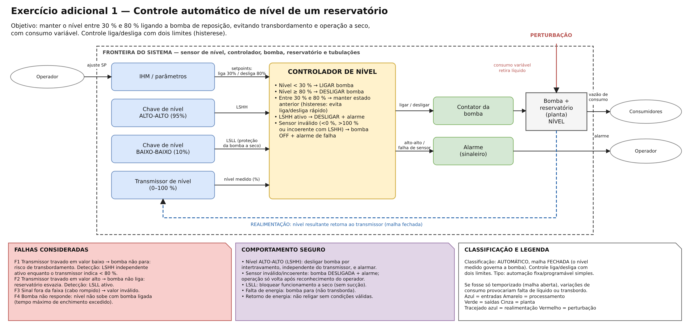

# Semana 1 — Fundamentos dos sistemas automatizados

**UC Sistemas Automatizados** · Prof. Calvetti · Engenharia de Software — USJT
**Autor:** Lucas Antonio Gomes (RA 823126987) · **Data:** [DATA DA ENTREGA]

## Conteúdo desta pasta

| Arquivo | Conteúdo |
|---|---|
| `diagramas.drawio` | Arquivo **editável** do diagrams.net com 4 páginas (uma por exercício) |
| `porta-automatica.png` | Exercício obrigatório — porta automática |
| `reservatorio.png` | Exercício adicional 1 — controle de nível |
| `iluminacao.png` | Exercício adicional 2 — iluminação de estacionamento |
| `proposta-propria-irrigacao.png` | Exercício adicional 3 — proposta própria (irrigação automática) |

Para editar: abra <https://app.diagrams.net> → *Arquivo → Abrir de → Dispositivo* → `diagramas.drawio`. As páginas ficam nas abas da parte de baixo da tela.

**Convenções usadas nos diagramas** (slide 56): seta entrando = entrada; bloco com verbo = processamento; seta saindo = saída; seta lateral vermelha = perturbação; nota = falha; seta tracejada azul = realimentação. Cores: azul = sensores/entradas, amarelo = processamento, verde = atuadores/saídas, cinza = planta.

---

## Exercício obrigatório — Porta automática de acesso a um edifício

### Objetivo (uma frase)
Abrir a porta para as pessoas que se aproximam e fechá-la depois da passagem, sem nunca fechar sobre alguém, mantendo a rota de fuga livre em emergência.

### Fronteira do sistema
- **Dentro:** sensores de presença, barreira fotoelétrica, fins de curso, seletor de modo, botão de emergência, controlador (lógica da porta), acionamento do motor, motor, correia e folha da porta, sinalização.
- **Fora:** pessoas, brigada/central de incêndio, rede elétrica do edifício, vento e ambiente.

### Classificação
**Automático** no ciclo normal: o sistema detecta a pessoa, decide e atua sem intervenção humana. A escolha do modo (AUTO / ABERTA / TRAVADA) e o rearme após emergência são **decisões humanas**. Tipo: automação **programável** simples (tempos e modos são parâmetros do controlador).

### Entradas, processamento e saídas

| Tipo | Elemento | Sinal / significado |
|---|---|---|
| Entrada | Sensor de presença (radar) | presença detectada |
| Entrada | Barreira fotoelétrica na passagem | barreira interrompida (obstáculo) |
| Entrada | Seletor de modo | AUTO / ABERTA / TRAVADA |
| Entrada | Botão de emergência / alarme de incêndio | comando prioritário |
| Entrada (realimentação) | Fins de curso ABERTA / FECHADA | posição real da folha |
| Processamento | Lógica da porta | avaliar autorização, decidir abrir/manter/fechar, supervisionar falhas |
| Saída | Acionamento do motor | abrir / fechar / parar |
| Saída | Sinalização (LED + sonoro) | indicar falha e emergência |

**Regras de processamento**
1. Modo AUTO **e** presença detectada → ABRIR.
2. Manter aberta enquanto houver presença **ou** barreira interrompida.
3. Fechar após 5 s de área livre.
4. Obstáculo durante o fechamento → PARAR e REABRIR.
5. Emergência → ABRIR e manter aberta (prioridade sobre todas as regras).
6. Fim de curso não atingido em 8 s ou sinal inválido de sensor → falha.

### Realimentação, perturbação e falha
- **Realimentação:** os fins de curso informam a posição real da folha; a lógica só considera "aberta/fechada" quando o fim de curso confirma, e interrompe o movimento se ele não chegar no tempo esperado.
- **Perturbação:** vento, empurrão manual da folha, atrito ou sujeira no trilho.
- **Falha principal:** sensor de presença/barreira com sinal inválido ou travado.

### Comportamento seguro
- Sinal inválido de barreira ou presença → **impedir o fechamento automático**, manter aberta e sinalizar falha.
- Obstáculo ao fechar → **parar e reabrir**.
- Emergência/incêndio → **abrir totalmente e manter aberta** (rota de fuga); só volta ao modo AUTO com rearme manual.
- Motor sem resposta → desligar o motor e alarmar.
- Falta de energia → folha liberada para abertura manual (estado mecânico seguro).

### Casos de teste e resultados

Validação feita percorrendo o modelo cenário a cenário (slide 60):

| Cenário | Entrada | Resposta esperada | Resposta do modelo | Situação |
|---|---|---|---|---|
| Aproximação válida | Presença detectada (modo AUTO) | Abrir porta | Regra 1 → ABRIR | Aprovado |
| Passagem concluída | Área livre por 5 s | Fechar após espera | Regra 3 → FECHAR | Aprovado |
| Obstáculo | Barreira interrompida durante fechamento | Parar e reabrir | Regra 4 → PARAR + ABRIR | Aprovado |
| Falha de sensor | Sinal inválido da barreira | Impedir fechamento automático | Estado seguro → mantém aberta + alarme | Aprovado |
| Emergência | Comando prioritário | Adotar estado seguro | Regra 5 → ABRIR e manter aberta | Aprovado |
| Motor não responde | Comando ABRIR sem fim de curso em 8 s | Parar e alarmar | Regra 6 → motor OFF + sinalização | Aprovado |

---

## Exercício adicional 1 — Reservatório (controle de nível)

- **Objetivo:** manter o nível entre 30 % e 80 %, evitando transbordamento e operação a seco.
- **Classificação:** automático, **malha fechada** (o nível medido governa a bomba).
- **Elementos:** planta = reservatório e tubulações; sensor = transmissor de nível (+ chaves ALTO-ALTO e BAIXO-BAIXO independentes); controlador = lógica de nível; atuador = bomba; perturbação = consumo variável.
- **Setpoint:** liga abaixo de 30 %, desliga ao atingir 80 % — **dois limites** criam uma faixa estável e evitam liga/desliga rápido.
- **Falhas:** transmissor travado (baixo ou alto), sinal fora da faixa, bomba sem resposta, **nível alto-alto**.
- **Estado seguro:** nível alto-alto ou sensor inválido → bomba desligada + alarme; sem religamento automático após falha.

| Caso | Nível / condição | Estado anterior da bomba | Esperado | Situação |
|---|---|---|---|---|
| R1 | 25 % | desligada | liga | Aprovado |
| R2 | 50 % | ligada | continua ligada (histerese) | Aprovado |
| R3 | 80 % | ligada | desliga | Aprovado |
| R4 | 50 % | desligada | continua desligada | Aprovado |
| R5 | LSHH ativo (95 %) com transmissor indicando 60 % | ligada | desliga + alarme de incoerência | Aprovado |
| R6 | Transmissor indica 120 % (inválido) | qualquer | bomba OFF + alarme de falha | Aprovado |

## Exercício adicional 2 — Iluminação automática de estacionamento

- **Entradas:** luminosidade (ESCURO), presença (PRESENÇA), horário (HORÁRIO), chave manual.
- **Processamento booleano (AUTO):** `LUZ = ESCURO AND PRESENÇA AND HORÁRIO`, mantida 3 min após a última presença.
- **Modo manual:** `MAN_LIGA` acende e `MAN_DESL` apaga, com prioridade sobre o automático.
- **Falha de sensor:** dentro do horário, fotocélula ou PIR inválido → luzes **acesas** + aviso (segurança das pessoas acima da economia).

| Caso | ESCURO | PRESENÇA | HORÁRIO | Modo | Esperado | Situação |
|---|---|---|---|---|---|---|
| L1 | 1 | 1 | 1 | AUTO | LUZ = 1 | Aprovado |
| L2 | 0 | 1 | 1 | AUTO | LUZ = 0 (dia claro) | Aprovado |
| L3 | 1 | 0 | 1 | AUTO | LUZ = 0 após 3 min sem presença | Aprovado |
| L4 | 1 | 1 | 0 | AUTO | LUZ = 0 (fora do horário) | Aprovado |
| L5 | qualquer | qualquer | qualquer | MAN_LIGA | LUZ = 1 | Aprovado |
| L6 | fotocélula inválida | 1 | 1 | AUTO | LUZ = 1 + aviso de falha | Aprovado |

## Exercício adicional 3 — Proposta própria: irrigação automática

- **Objetivo e usuário:** manter a umidade do solo de um jardim/horta de condomínio; usuário = morador ou zelador.
- **Grau e tipo de automação:** automático com comando manual; automação programável (horários e limites ajustáveis); malha fechada pela umidade do solo.
- **Modelo E–P–S:** umidade, chuva, relógio, botão manual e vazão → controlador → válvula solenoide e aviso.
- **Perturbações:** sol/evaporação, chuva, vento, variação da pressão da rede.
- **Riscos e estado seguro:** válvula presa aberta (desperdício/alagamento), sensor travado, falta d'água. Estado seguro = **válvula normalmente fechada**, tempo máximo de irrigação de 20 min, válvula mestre fecha em caso de vazamento.
- **Melhoria justificada:** consultar a previsão do tempo e pular a rega se houver chuva prevista nas próximas 12 h, mantendo o sensor de chuva local como proteção se a internet falhar. Economia de água sem perder a proteção local.

---

## Matriz mínima de riscos (porta automática)

| Falha | Efeito | Detecção | Resposta segura |
|---|---|---|---|
| Sensor de presença travado | Porta não abre ou não fecha | Sinal sem variação por tempo excessivo (incoerência temporal) | Bloquear fechamento automático, manter aberta, sinalizar |
| Barreira fotoelétrica com defeito | Risco de fechar sobre pessoa | Autoteste da barreira antes de cada fechamento | Não fechar; alarmar manutenção |
| Perda de energia | Parada do sistema | Ausência de alimentação | Folha liberada para abertura manual (estado mecânico seguro) |
| Comando indevido de fechar | Fechar com pessoa na passagem | Permissivos (barreira livre, sem presença) | Rejeitar o comando |
| Atuador não responde | Porta não abre/fecha | Realimentação: fim de curso não chega em 8 s | Parar o motor e alarmar |

## Checklist de qualidade

- [x] A fronteira do sistema está clara (retângulo tracejado em todos os diagramas).
- [x] Cada seta possui significado (rótulos nas setas).
- [x] Entradas e saídas não foram confundidas (cores e lados opostos).
- [x] O processamento contém decisões verificáveis (regras numeradas).
- [x] Há realimentação quando necessária (seta tracejada azul).
- [x] Falhas e estado seguro foram tratados (notas inferiores).
- [x] O README permite compreender o diagrama sem explicação oral.

## Active recall (respostas próprias)

1. **Manual × semiautomático × automático:** quem decide e quem executa. No manual a pessoa decide e executa (abrir um registro); no semiautomático a pessoa autoriza e a máquina executa a sequência (uma lavadora que só começa quando se aperta INICIAR); no automático o sistema percebe, decide e atua sozinho (um termostato de geladeira).
2. **Quando a realimentação é necessária:** quando perturbações ou incertezas impedem garantir o resultado só com uma ação fixa. Exemplo: o ar-condicionado precisa medir a temperatura porque a quantidade de pessoas na sala muda.
3. **Sensor × atuador:** o sensor converte uma grandeza física em informação (termômetro do forno); o atuador converte um comando em ação física (resistência do forno).
4. **Falha segura:** quando algo falha, o sistema vai para o estado que causa menos dano, e não necessariamente "desliga tudo". Exemplo: um elevador sem energia trava os freios em vez de soltar a cabine.
5. **Software com consequência física:** um erro de lógica comanda um atuador real. Exemplo: um `>=` trocado por `>` em uma irrigação pode deixar a válvula aberta e alagar o jardim.

## Limitações

Os diagramas são modelos funcionais. Não dimensionam componentes nem substituem análise de risco normativa (por exemplo, normas de portas automáticas e de segurança de máquinas). Nenhum dado real de processo industrial foi utilizado.
