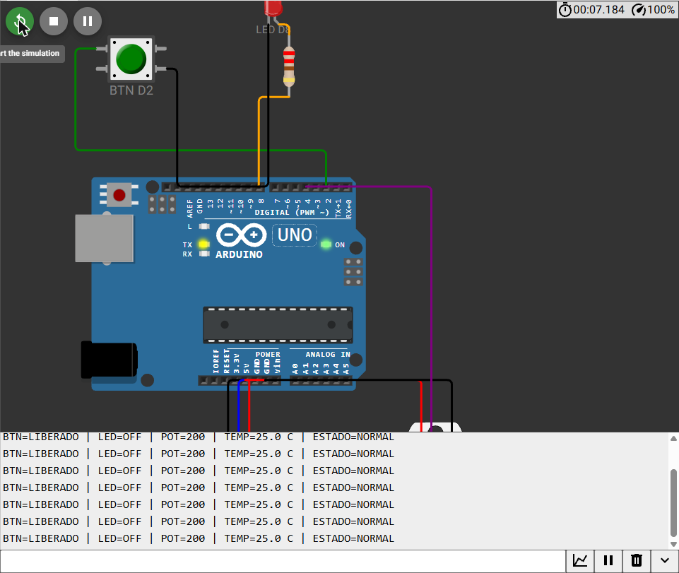

# Semana 2 — Processos, sensores e transdutores

**UC Sistemas Automatizados** · Prof. Calvetti · Engenharia de Software — USJT
**Autor:** Lucas Antonio Gomes (RA 823126987) · **Data da execução:** 29/08/2026

**Projeto no Wokwi:** executado e testado no Wokwi (capturas em `evidencias/`). O projeto não foi publicado; para reproduzir, basta colar `diagram.json` e `sketch.ino` em um novo projeto Arduino Uno (passo a passo abaixo).

## Objetivo

Construir no Wokwi uma **estação de monitoramento** com uma entrada digital (botão), uma entrada analógica (potenciômetro), uma medição de temperatura (DHT22) e uma sinalização (LED). O programa classifica o estado em **NORMAL, ATENÇÃO, ALARME e FALHA DE SENSOR** e publica o diagnóstico no Monitor Serial.

## Estrutura

```
semana-02-sensores/
├── README.md
├── sketch.ino            ← programa final (prioridade + histerese)
├── diagram.json          ← circuito do Wokwi
├── libraries.txt         ← bibliotecas do projeto
├── etapas/               ← incrementos usados na construção (1 a 5)
├── evidencias/           ← capturas de tela do Wokwi
└── testes/
    └── casos-de-teste.md
```

## Relação entre componente didático e função industrial

| Variável do processo | Sensor didático | Entrada no Arduino | Resposta do sistema | Equivalente industrial |
|---|---|---|---|---|
| Presença / posição (discreta) | Pushbutton | D2 (digital, `INPUT_PULLUP`) | acende o LED em D8 | fim de curso, sensor indutivo, pressostato |
| Variável contínua (ex.: pressão) | Potenciômetro | A0 (analógica, 0–1023) | NORMAL / ATENÇÃO / ALARME | transmissor analógico 4–20 mA |
| Temperatura | DHT22 | D4 (digital codificada) | ATENÇÃO / ALARME / FALHA | RTD Pt100 ou termopar + transmissor |
| Sinalização | LED + 220 Ω | D8 (saída digital) | — | sinaleiro ou relé |
| Controlador | Arduino Uno | — | — | CLP ou controlador embarcado |

## Mapa de pinos e circuito

| Componente | Pino do Arduino | Ligação complementar | Razão |
|---|---|---|---|
| Pushbutton | D2 | outro terminal em GND | entrada digital com pull-up interno |
| LED + resistor | D8 | D8 → 220 Ω → ânodo; cátodo → GND | limitar corrente e sinalizar |
| Potenciômetro | A0 | VCC → 5 V; GND → GND; SIG → A0 | produzir tensão variável |
| DHT22 | D4 | VCC → 5 V; GND → GND; DATA → D4 | fornecer temperatura simulada |

Com `INPUT_PULLUP` a lógica física é invertida: **liberado = HIGH e pressionado = LOW**. A variável `detectado = digitalRead(BTN) == LOW` corrige o significado.

## Regras de decisão (em ordem de prioridade)

| Prioridade | Estado | Regra |
|---|---|---|
| 1 | FALHA DE SENSOR | temperatura inválida (`isnan(t)`) |
| 2 | ALARME | alarme de temperatura (liga em t ≥ 40 °C, desliga em t ≤ 37 °C) **ou** pot ≥ 750 |
| 3 | ATENÇÃO | t ≥ 30 °C **ou** pot ≥ 400 |
| 4 | NORMAL | nenhuma regra anterior |

| Variável | Normal | Atenção | Alarme / Falha |
|---|---|---|---|
| Potenciômetro | 0–399 | 400–749 | 750–1023 |
| Temperatura | < 30 °C | 30 a < 40 °C | ≥ 40 °C (desliga em ≤ 37 °C) |
| DHT inválido | — | — | FALHA DE SENSOR |
| Botão | liberado | — | pressionado acende o LED |

A falha é avaliada primeiro porque uma medida inválida não sustenta nenhuma conclusão sobre o processo. NORMAL é o caso residual.

## Como reproduzir no Wokwi

1. Acesse <https://wokwi.com> → **New Project** → **Arduino Uno**.
2. Na aba `diagram.json`, substitua todo o conteúdo pelo arquivo `diagram.json` desta pasta (o circuito aparece montado). Se preferir montar à mão, siga o mapa de pinos acima.
3. Na aba `sketch.ino`, cole o conteúdo de `sketch.ino`.
4. Em **Library Manager** (ou criando o arquivo `libraries.txt`), adicione **DHT sensor library** (Adafruit) e, se pedido, **Adafruit Unified Sensor**.
5. Clique em ▶ e abra o Monitor Serial (9600 bit/s). Cada segundo aparece uma linha como:
   `BTN=LIBERADO | LED=OFF | POT=200 | TEMP=25.0 C | ESTADO=NORMAL`
6. Clique no potenciômetro ou no DHT22 durante a simulação para alterar os valores e execute os casos de `testes/casos-de-teste.md`.

A pasta `etapas/` guarda os incrementos da construção (digital → analógico → classificação → DHT22 → integrado sem histerese). Cada um pode ser colado no Wokwi para conferir uma etapa isolada.

## Casos de teste — resumo

Todos os casos abaixo foram executados no Wokwi. Capturas: [`evidencias/testes-integrados.png`](evidencias/testes-integrados.png).



A tabela completa (digitais, fronteiras, T1–T7, P1–P5 e histerese H1–H8) está em [`testes/casos-de-teste.md`](testes/casos-de-teste.md).

| Caso | Pot. | Temp. | Botão | Esperado | Obtido | Situação |
|---|---|---|---|---|---|---|
| T1 | 200 | 25 °C | livre | NORMAL; LED off | NORMAL; LED off | Aprovado |
| T2 | 500 | 25 °C | livre | ATENÇÃO | ATENCAO | Aprovado |
| T3 | 800 | 25 °C | livre | ALARME | ALARME | Aprovado |
| T4 | 200 | 35 °C | livre | ATENÇÃO | ATENCAO | Aprovado |
| T5 | 200 | 45 °C | livre | ALARME | ALARME | Aprovado |
| T6 | 200 | 25 °C | pressionado | NORMAL; LED on | NORMAL; LED on | Aprovado |
| T7 | — | inválida | livre | FALHA DE SENSOR | FALHA DE SENSOR | Aprovado |

## Exercícios adicionais

### 1 — Prioridade de alarmes
A decisão foi encapsulada em `classificar(t, bruto)`, que devolve o estado. A ordem dos `if` materializa a prioridade **FALHA > ALARME > ATENÇÃO > NORMAL**. Os cinco novos casos (P1–P5) estão em `testes/casos-de-teste.md`. P5 (pot = 900 e temperatura inválida) prova que a falha de instrumento não é confundida com alarme nem com normalidade.

### 2 — Histerese
Sem histerese, oscilações em torno de 40 °C alternariam ATENÇÃO/ALARME a cada leitura. A variável global `alarmeTemperatura` guarda o estado anterior: liga em **t ≥ 40 °C**, mantém enquanto **t > 37 °C** e desliga apenas em **t ≤ 37 °C**. A sequência H1–H8 e o teste complementar 39,8 → 37,0 foram aprovados. Em H6 o resultado é ATENÇÃO (e não NORMAL) porque a regra de atenção (t ≥ 30 °C) continua válida.

### 3 — Seleção industrial
**Processo escolhido:** monitoramento de uma câmara térmica de processo (porta, pressão da linha de circulação e temperatura interna).

| Entrada didática | Mensurando | Tecnologia industrial | Faixa | Interface | Ambiente e justificativa |
|---|---|---|---|---|---|
| Pushbutton | porta fechada | chave fim de curso industrial ou sensor indutivo | 2 estados | 24 Vcc discreta | fim de curso é robusto e simples; o indutivo evita contato se o alvo for metálico |
| Potenciômetro | pressão da linha | transmissor de pressão | 0–10 bar | 4–20 mA | sinal robusto a distância e ruído; 4 mA = zero vivo |
| DHT22 | temperatura interna | RTD Pt100 + transmissor | 0–150 °C | 4–20 mA | Pt100 é estável e adequado à faixa; o transmissor padroniza o sinal |

| Instrumento | Falha detectável | Falha não detectável só pela entrada |
|---|---|---|
| Sensor da porta | circuito aberto (com diagnóstico elétrico) | sensor deslocado mecanicamente mas ainda comutando |
| Transmissor de pressão | corrente fora da faixa diagnóstica (< 3,6 mA) | deriva dentro da faixa que ainda parece plausível |
| Pt100 + transmissor | ruptura do elemento indicada pelo transmissor | pequeno erro sistemático sem calibração/comparação |

## Limitações da simulação

| O Wokwi demonstra | O Wokwi não valida |
|---|---|
| aquisição de entradas digitais e analógicas | alcance, tempo de resposta real e tolerâncias |
| prioridade e coerência da lógica | ruído elétrico, aterramento e compatibilidade eletromagnética |
| atuação e diagnóstico no Monitor Serial | montagem, cabeamento, invólucro e grau de proteção (IP) |
| testes de fronteira e rastreabilidade | calibração metrológica e segurança funcional (SIL/PL) |

A simulação comprova a **estrutura funcional** da leitura, decisão, atuação e diagnóstico. Não comprova a adequação física dos instrumentos industriais da seleção acima.

## Active recall

1. **Sensor × transdutor × transmissor:** o sensor é o elemento que reage ao fenômeno; o transdutor converte uma forma de energia em outra (ex.: temperatura → resistência); o transmissor condiciona e padroniza o sinal para transmissão (ex.: 4–20 mA). Um Pt100 com transmissor tem os três papéis.
2. **Digital não significa preciso:** o DHT22 entrega um número digital, mas sua exatidão é limitada pelo elemento sensor (±0,5 °C). Digital descreve a forma do sinal, não a qualidade da medida.
3. **Resolução × repetibilidade:** resolução é a menor variação que o instrumento consegue indicar (passo de 0,1 °C); repetibilidade é o quanto ele repete o mesmo valor para a mesma condição. Um sensor pode ter boa resolução e indicar 25,3 / 25,9 / 25,1 para a mesma temperatura.
4. **Detectar metal:** sensor indutivo, porque responde a alvos metálicos sem contato e é robusto a poeira e óleo.
5. **O que o Wokwi não valida:** ruído eletromagnético, aterramento, calibração e segurança funcional, entre outros (tabela acima).
