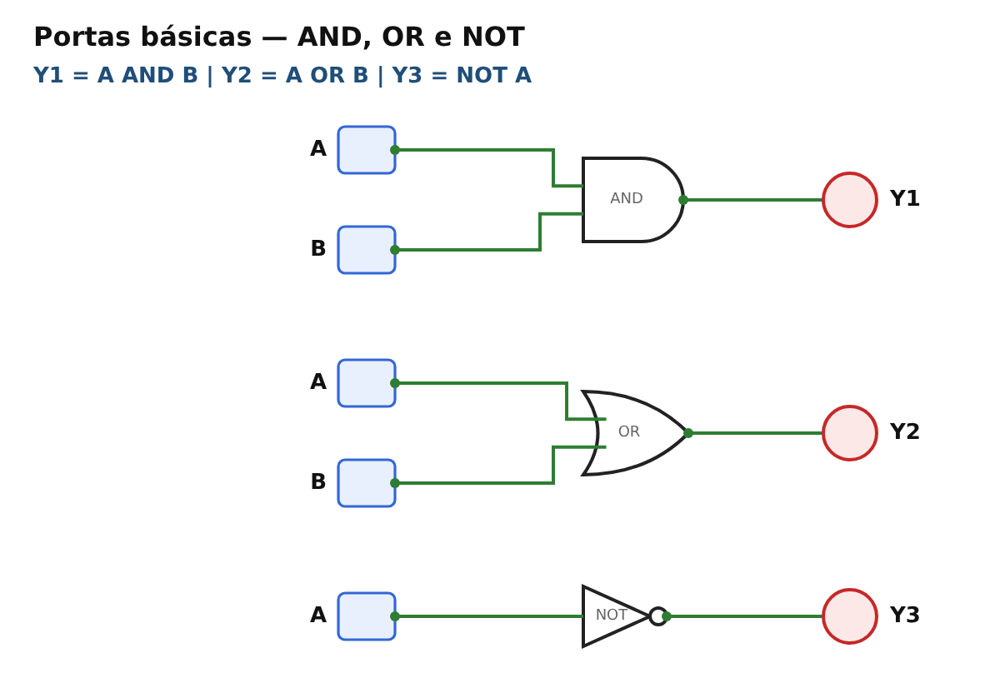
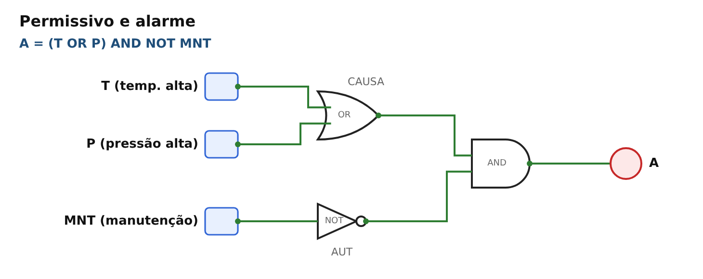
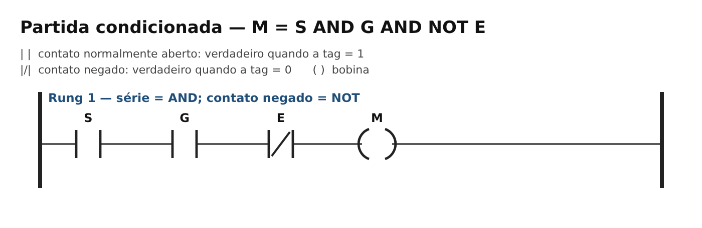
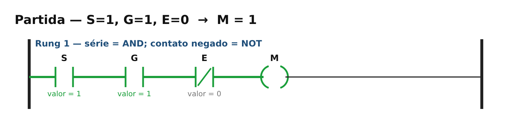
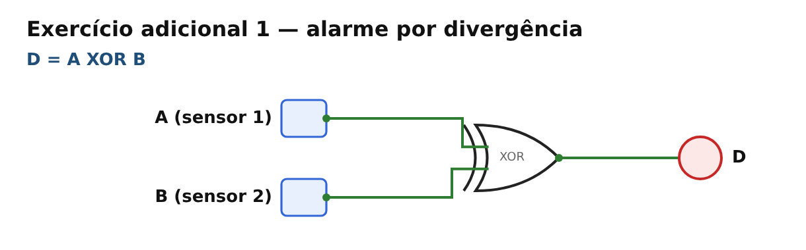
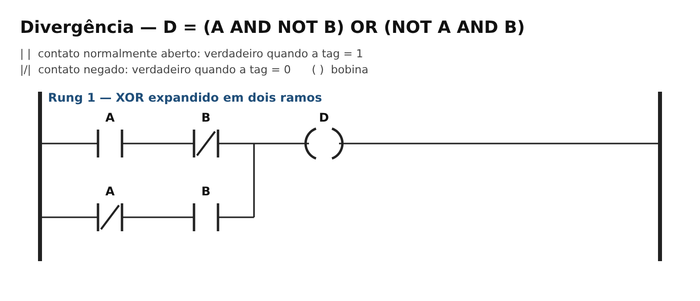

# Semana 04 — Sistemas discretos e lógica combinacional

**UC Sistemas Automatizados** · Prof. Calvetti · Engenharia de Software — USJT
**Autor:** Lucas Antonio Gomes (RA 823126987) · **Data:** 12/09/2026

## Simulações

- CircuitVerse: [abrir circuito](https://circuitverse.org/users/473233/projects/2082396)
- PLC Simulator Online: [abrir Ladder](https://app.plcsimulator.online/xEyjH4qmKkzYcfsuWVCH)

## Estrutura

```
semana-04-logica/
├── README.md
├── casos_teste.csv          ← 57 casos: esperado, obtido, situação
├── circuitos/               ← redes de portas (referência para montar no CircuitVerse)
├── ladder/                  ← programas Ladder (referência para o PLC Simulator Online)
│   └── estado-*.png         ← estados decisivos: partida, proteção aberta, emergência
└── capturas/                ← capturas de tela dos simuladores
```

## Variáveis e convenções

Lógica positiva: **1 = proposição verdadeira**.

| Variável | 0 (FALSE) | 1 (TRUE) |
|---|---|---|
| S — START | botão liberado | botão pressionado |
| G — GUARD | proteção aberta | proteção fechada |
| E — EMERGENCY | não acionada | acionada |
| M — MOTOR | desenergizado | energizado (autorizado) |
| T / P | temperatura / pressão normal | temperatura / pressão alta |
| MNT | manutenção inativa | manutenção ativa |
| CA / CB | sem comando | comando do motor A / B |

E = 1 significa emergência **acionada**; por isso ela aparece como `NOT E` nas autorizações. Isso não define o tipo físico do contato (NA/NF) do botão real.

Precedência adotada: NOT, depois AND, depois OR/XOR; parênteses sempre explícitos.

## Expressões

| Saída | Expressão | Leitura |
|---|---|---|
| M | `M = S AND G AND NOT E` | parte somente com START, proteção fechada e sem emergência |
| A | `A = (T OR P) AND NOT MNT` | alarme por temperatura ou pressão, inibido em manutenção |
| MA, MB | `MA = CA AND NOT MB AND NOT E` · `MB = CB AND NOT MA AND NOT E` | intertravamento didático + emergência |
| AL_E | `AL_E = E` | alarme de emergência |
| D | `D = A XOR B = (A AND NOT B) OR (NOT A AND B)` | divergência entre sensores |
| V | `V = D AND G AND NOT F` | ventilação permissiva |
| MA_seguro, MB_seguro | `MA_seguro = CA AND NOT E` · `MB_seguro = CB AND NOT CA AND NOT E` | arbitragem com prioridade A |

## Teoria — exercícios resolvidos

- **Alarme condicionado:** `A = (T OR P) AND NOT MNT`. Caso T=0, P=1, MNT=0 → A=1; caso T=1, P=0, MNT=1 → A=0. Inibir alarme em manutenção só é aceitável se a análise de risco justificar.
- **Simplificação:** `Y = (A AND B) OR (A AND NOT B) = A AND (B OR NOT B) = A AND 1 = A`. B não influencia a saída; se deveria influenciar, o requisito precisa ser revisto.
- **Teste de mutação:** a expressão errada `M = (S AND G) OR NOT E` falha no caso S=0, G=0, E=0: dá M=1 sem pedido de partida e com a proteção aberta. Correção: `M = S AND G AND NOT E`. Por isso a tabela-verdade completa é mais confiável que testar só o caso "tudo certo".

## 1. CircuitVerse — portas básicas e partida condicionada




**Como montar:** <https://circuitverse.org/simulator> → circuito em branco → *Input* para cada variável (renomeie com o nome da tag) → portas *AND / OR / NOT / XOR* → *Output* ou *LED* para a saída. Para a partida, use NOT em E e uma AND de 3 entradas (em *Properties*, *Input Size* = 3) ou duas AND em cascata. Clique nas entradas para alternar 0/1 e registre a saída. Salve com *Save Online* e use *Share* para gerar o link público.

| Circuito | A | B | Esperado | Obtido | Situação |
|---|---|---|---|---|---|
| AND | 0 | 0 | 0 | 0 | PASSA |
| AND | 0 | 1 | 0 | 0 | PASSA |
| AND | 1 | 0 | 0 | 0 | PASSA |
| AND | 1 | 1 | 1 | 1 | PASSA |
| OR | 0 | 0 | 0 | 0 | PASSA |
| OR | 0 | 1 | 1 | 1 | PASSA |
| OR | 1 | 0 | 1 | 1 | PASSA |
| OR | 1 | 1 | 1 | 1 | PASSA |
| NOT | 0 | – | 1 | 1 | PASSA |
| NOT | 1 | – | 0 | 0 | PASSA |

### Partida condicionada — tabela-verdade completa (2³ = 8 combinações)

| ID | S | G | E | NOT E | M esperado | M obtido | Situação |
|---|---:|---:|---:|---:|---:|---:|---|
| P01 | 0 | 0 | 0 | 1 | 0 | 0 | PASSA |
| P02 | 0 | 0 | 1 | 0 | 0 | 0 | PASSA |
| P03 | 0 | 1 | 0 | 1 | 0 | 0 | PASSA |
| P04 | 0 | 1 | 1 | 0 | 0 | 0 | PASSA |
| P05 | 1 | 0 | 0 | 1 | 0 | 0 | PASSA |
| P06 | 1 | 0 | 1 | 0 | 0 | 0 | PASSA |
| P07 | 1 | 1 | 0 | 1 | 1 | 1 | PASSA |
| P08 | 1 | 1 | 1 | 0 | 0 | 0 | PASSA |

Somente a combinação **SGE = 110** autoriza o motor.

## 2. Permissivo e alarme



| T | P | MNT | T OR P | NOT MNT | A esperado | A obtido | Situação |
|---|---|---|---|---|---|---|---|
| 0 | 0 | 0 | 0 | 1 | 0 | 0 | PASSA |
| 0 | 1 | 0 | 1 | 1 | 1 | 1 | PASSA |
| 1 | 0 | 0 | 1 | 1 | 1 | 1 | PASSA |
| 1 | 1 | 0 | 1 | 1 | 1 | 1 | PASSA |
| 0 | 0 | 1 | 0 | 0 | 0 | 0 | PASSA |
| 0 | 1 | 1 | 1 | 0 | 0 | 0 | PASSA |
| 1 | 0 | 1 | 1 | 0 | 0 | 0 | PASSA |
| 1 | 1 | 1 | 1 | 0 | 0 | 0 | PASSA |

## 3. Intertravamento entre motores e emergência prioritária


A regra didática `MA = CA AND NOT MB` / `MB = CB AND NOT MA` usa as saídas como realimentação; o resultado depende do **estado anterior** e da **ordem de avaliação**. Política declarada para o conflito CA = CB = 1 a partir do repouso: **o rung de MA é avaliado primeiro**, então A vence. A emergência entra por último em todas as autorizações (`AND NOT E`) e diretamente no alarme (`AL_E = E`).

| Caso | CA | CB | MA ant. | MB ant. | Esperado | Obtido | Situação |
|---|---|---|---|---|---|---|---|
| I1 | 0 | 0 | 0 | 0 | MA=0; MB=0 | MA=0; MB=0 | PASSA |
| I2 | 1 | 0 | 0 | 0 | MA=1; MB=0 | MA=1; MB=0 | PASSA |
| I3 | 0 | 1 | 0 | 0 | MA=0; MB=1 | MA=0; MB=1 | PASSA |
| I4 | 1 | 1 | 1 | 0 | MA permanece prioritário | MA=1; MB=0 | PASSA |
| I5 | 1 | 1 | 0 | 1 | MB permanece prioritário | MA=0; MB=1 | PASSA |
| I6 | 1 | 1 | 0 | 0 | política definida (A primeiro) | MA=1; MB=0 | PASSA |

| Caso | Antes | Ação | Esperado | Obtido | Situação |
|---|---|---|---|---|---|
| E01 | motor desligado | E=1 | motores=0; AL_E=1 | MA=0; MB=0; AL_E=1 | PASSA |
| E02 | motor A ligado | E=1 | MA=0; AL_E=1 | MA=0; MB=0; AL_E=1 | PASSA |
| E03 | motor B ligado | E=1 | MB=0; AL_E=1 | MA=0; MB=0; AL_E=1 | PASSA |
| E04 | E=1 | CA=1 e CB=1 | MA=0; MB=0 | MA=0; MB=0; AL_E=1 | PASSA |
| E05 | E retorna a 0 | nenhum novo comando | não religar automaticamente | MA=0; MB=0 | PASSA |

Em todos os casos `MA AND MB = 0`. A lógica combinacional desta semana não tem memória nem rearme; na solução sequencial (Semana 6) será exigido novo comando de partida depois da emergência.

## 4. PLC Simulator Online — reprodução em Ladder

| Representação | AND | OR | NOT | Saída |
|---|---|---|---|---|
| CircuitVerse | porta AND | porta OR | porta NOT | output/LED |
| Ladder | contatos em **série** | ramos em **paralelo** | contato **negado** `|/|` | bobina `( )` |



**Como montar:** <https://plcsimulator.online/> → diagrama em branco → crie as variáveis booleanas S, G, E e M → no rung, contato NA de S, contato NA de G, contato **negado** de E (em série) e bobina M no fim → modo de simulação → alterne S, G e E nas 8 combinações → salve e gere o link.

**Execução no simulador:** todos os circuitos da semana foram colocados em um único programa de 12 rungs no PLC Simulator Online (link no topo). Para não haver conflito de nomes entre circuitos, as portas básicas usam `IA`, `IB` → `Y1`, `Y2`, `Y3`; a divergência usa `SA`, `SB` → `D`; a ventilação usa `VD`, `VG`, `VF` → `V`. Partida, alarme, intertravamento e arbitragem usam as tags originais (o intertravamento e a arbitragem compartilham os comandos `CA`, `CB` e `E`, com saídas diferentes: `MA`/`MB` e `MA_seguro`/`MB_seguro`). As 57 combinações de `casos_teste.csv` foram repetidas no simulador e deram o mesmo resultado (coluna `conferido_plc_simulator`).


Estados de referência desenhados (verde = condição verdadeira / fluxo de energia lógica):

| P07 — partida autorizada | P08 — emergência | P03 — proteção aberta, sem START |
|---|---|---|
|  |  |  |

Demais programas Ladder: [`ladder/02-alarme-condicionado.png`](ladder/02-alarme-condicionado.png), [`ladder/05-intertravamento-emergencia.png`](ladder/05-intertravamento-emergencia.png).

## 5. Exercícios adicionais

### 5.1 Alarme por divergência — `D = A XOR B`




| A | B | D esperado | D obtido | Interpretação |
|---|---|---|---|---|
| 0 | 0 | 0 | 0 | concordância em 0 |
| 0 | 1 | 1 | 1 | divergência |
| 1 | 0 | 1 | 1 | divergência |
| 1 | 1 | 0 | 0 | concordância em 1 |

Limite: concordância não prova que os sensores estão certos (podem falhar do mesmo modo), e a divergência não indica qual deles está errado.

### 5.2 Ventilação permissiva — `V = D AND G AND NOT F`


| D | G | F | V esperado | V obtido | Situação |
|---|---|---|---|---|---|
| 0 | 0 | 0 | 0 | 0 | PASSA |
| 0 | 0 | 1 | 0 | 0 | PASSA |
| 0 | 1 | 0 | 0 | 0 | PASSA |
| 0 | 1 | 1 | 0 | 0 | PASSA |
| 1 | 0 | 0 | 0 | 0 | PASSA |
| 1 | 0 | 1 | 0 | 0 | PASSA |
| 1 | 1 | 0 | 1 | 1 | PASSA |
| 1 | 1 | 1 | 0 | 0 | PASSA |

Teste de prioridade: com V = 1, mudar F para 1 leva V a 0 imediatamente.

### 5.3 Arbitragem de motores — política "A tem prioridade sobre B"


`MA = CA` e `MB = CB AND NOT CA`, sem dependência circular do estado anterior. Com emergência: `MA_seguro = CA AND NOT E`, `MB_seguro = CB AND NOT CA AND NOT E`.

| CA | CB | E | MA | MB | MA AND MB |
|---|---|---|---|---|---|
| 0 | 0 | 0 | 0 | 0 | 0 |
| 0 | 1 | 0 | 0 | 1 | 0 |
| 1 | 0 | 0 | 1 | 0 | 0 |
| 1 | 1 | 0 | 1 | 0 | 0 |
| qualquer | qualquer | 1 | 0 | 0 | 0 |

## Casos de teste

O arquivo [`casos_teste.csv`](casos_teste.csv) traz os **57 casos** (portas básicas, partida, alarme, intertravamento, emergência, XOR, ventilação e arbitragem com as 8 combinações de CA/CB/E). A coluna `obtido_modelo_ladder` foi obtida executando os programas Ladder desta pasta varredura a varredura; os 57 casos foram repetidos no CircuitVerse (coluna `conferido_circuitverse`) e no PLC Simulator Online (coluna `conferido_plc_simulator`). **Todos os 57 casos passaram.**

## Capturas

Capturas tiradas nos simuladores, pasta `capturas/`:

| Arquivo | Estado |
|---|---|
| `circuitverse-visao-geral.png` | os 7 circuitos montados no CircuitVerse |
| `circuitverse-partida-P07.png` | S=1, G=1, E=0 → M=1 |
| `circuitverse-emergencia-P08.png` | S=1, G=1, E=1 → M=0 |
| `circuitverse-intertravamento-I6.png` | CA=1 e CB=1 a partir do repouso → só MA_seguro=1 |
| `ladder-partida-P07.png` | Ladder: S=1, G=1, E=0 → M=1 |
| `ladder-emergencia-P08.png` | Ladder: E=1 bloqueia M e liga AL_E |
| `ladder-intertravamento.png` | Ladder: CA=1 e CB=1 → MA=1, MB=0 |

## Active recall

1. **Frase → lógica booleana:** definir proposições binárias sem ambiguidade, traduzir "e" (AND), "ou" (OR), "não" (NOT), colocar parênteses, enumerar 2ⁿ combinações e conferir cada linha com o requisito.
2. **XOR em vez de OR:** quando a saída deve indicar diferença ou exclusividade. OR dá 1 quando as duas entradas valem 1; XOR dá 0.
3. **AND e OR em Ladder:** AND = contatos em série; OR = ramos em paralelo; NOT = contato negado.
4. **Caso que revela `M = (S AND G) OR NOT E`:** S=0, G=0, E=0 → M=1, embora não haja pedido e a proteção esteja aberta.
5. **Falha segura no protótipo:** emergência ou condição impeditiva levam as saídas de movimento a 0. O estado seguro real depende da análise de risco.
6. **Evidência reproduzível:** links públicos, expressões, convenção 0/1, tabelas completas com esperado/obtido, capturas decisivas e este README.

## Conclusão e limites

As quatro representações (requisito, expressão, tabela-verdade, circuito de portas e Ladder) apresentaram o mesmo comportamento em todas as combinações. O intertravamento por realimentação mostrou que o resultado com comandos simultâneos depende do estado anterior e da ordem de avaliação; por isso foi adotada uma política explícita (prioridade A).

**Limites:** uma porta lógica ou um rung demonstra comportamento lógico, mas **não certifica uma função de segurança**. Componentes, arquitetura, diagnóstico, categoria e nível de desempenho (ISO 13849 / IEC 62061) exigem projeto e validação próprios. A simulação não avalia contatos soldados, falhas de fiação ou tempo de parada.
